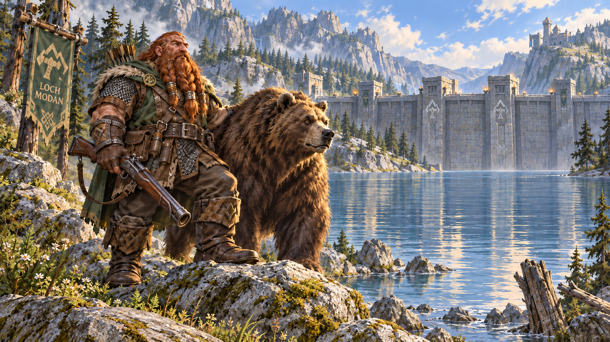

<p align="center">
  
</p>

# Omarchy Dwarf Hunter Theme

An Omarchy theme for bright mountain mornings. A dwarf and his bear look out over a sunlit Loch Modan, and the palette follows: pale lichen stone, deep loch blue, moss green and rusted leather.

This is a light theme (`mode = "light"`).

## Install

```sh
omarchy-theme-install https://github.com/csfh/omarchy-dwarf-hunter-theme
```

You can also install it from the Omarchy menu with `Super + Alt + Space`, then `Install > Style > Theme`, using this repository URL:

```text
https://github.com/csfh/omarchy-dwarf-hunter-theme
```

## Palette

| Role | Hex |
| --- | --- |
| Background | `#eef0ec` |
| Foreground | `#1a1e26` |
| Accent | `#2a62a8` |
| Red | `#b04a2a` |
| Green | `#4d772b` |
| Yellow | `#8a6718` |
| Blue | `#2a62a8` |
| Magenta | `#8e4a70` |
| Cyan | `#2a7585` |

## Included

A `colors.toml` palette, an icon theme (`Yaru-blue`) and a wallpaper. Omarchy builds the terminal, editor, launcher, notification, bar, lock screen, browser and TUI themes from this palette, so `colors.toml` is the single source of truth.

## Backgrounds

The wallpaper:

- [`dwarf-hunter`](backgrounds/dwarf-hunter.png)

## License

MIT. See [LICENSE](LICENSE). Copyright (c) 2026 Christoffer Hallas.

If you send a pull request or other contribution, you agree to the [CLA](CLA.md).
